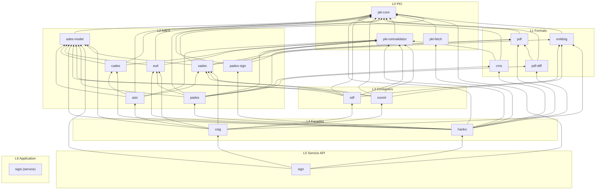

# Workspace crates and layering

Status: 2026-11-12 (lead round 2). Owner: the lead. The graph below is
generated from `cargo metadata` with `tools/crate-graph.py`; regenerate it
after changing dependencies.

## Layers

| Layer | Crates (directory → package) | Purpose |
| --- | --- | --- |
| L0 PKI | `pki-core` → `sigis-pki-core`, `pki-certvalidator` → `sigis-pki-certvalidator`, `pki-fetch` → `sigis-pki-fetch` | Shared types, algorithms, certificate path validation and revocation, fetchers |
| L1 Formats | `cms` → `sigis-cms`, `pdf` → `sigis-pdf`, `pdf-diff` → `sigis-pdf-diff`, `xmldsig` → `sigis-xmldsig` (new) | Signature formats: CMS validation, PDF structure, PDF modification analysis, XML-DSig with a security policy |
| L2 AdES | `ades-model` → `sigis-ades-model` (new), `eutl` → `sigis-eutl`, `pades` → `sigis-pades`, `pades-sign` → `sigis-pades-sign`, `cades` → `sigis-cades` (new), `xades` → `sigis-xades` (new), `asic` → `sigis-asic` (new) | AdES levels, verdicts and reports; trusted lists |
| L3 Containers | `ooxml` → `sigis-ooxml` (new), `odf` → `sigis-odf` (new) | Office document signatures |
| L4 Facades | `hanko` → `sigis-hanko` (pyHanko port: PDF + CMS), `xsig` → `sigis-xsig` (new, XML) | Re-exports only; parallel, no dependency between them |
| L5 Service API | `sign` → `sigis-sign` (new) | Unified sign / verify / report API, feature-gated (`pdf` → `sigis-hanko`, `xml` → `sigis-xsig`) |
| L6 Application | root `sigis`; `cli` → `sigis-cli` | HTTP service and pyHanko-compatible CLI (round-3 lane C) |
| Test support | `testdata` → `sigis-testdata` | Fixtures; dev-dependency only |

Packages are prefixed `sigis-` because several short names (`cms`, `pdf`)
are crates on crates.io that the workspace also uses.

Renamed on 2026-11-12: `hanko-core` → `pki-core`, `hanko-certvalidator` →
`pki-certvalidator`, `hanko-fetch` → `pki-fetch`, `hanko-cms` → `cms`,
`hanko-pdf` → `pdf`, `hanko-diff` → `pdf-diff`, `hanko-eutl` → `eutl`,
`hanko-sign` → `pades-sign`, `hanko-testdata` → `testdata`;
`hanko-validate` and `hanko-ades` were merged into `pades` (AdES validation
is the module `sigis_pades::ades`); `SignatureValidationError` moved from
`hanko-validate` to `ades-model`. Lane branches based on the old layout run
`tools/migrate-crate-names.sh` (see §4).

## Layering rule

1. A crate may depend (normal or build dependency) only on crates of a
   **strictly lower** layer.
2. Same-layer dependencies are forbidden, except the pairs listed in
   `tools/layers.json` → `same_layer_allowed` (e.g. `pdf-diff → pdf`,
   `pades → eutl`, `asic → cades/xades`, everything in L2 → `ades-model`).
   The two L4 facades never depend on each other.
3. `sigis-testdata` is only ever a dev-dependency.
4. Every workspace package has a layer in `tools/layers.json`.
5. Dev-dependencies are exempt from 1–2 (a test may use a higher layer, e.g.
   signing tests validating with `sigis-pades`), as long as no cycle arises.

The rule is checked by the root package's test `tests/layering.rs`
(`cargo test --test layering`), part of the workspace gate. It reads
`cargo metadata --no-deps` and fails on any violation; adding a crate or a
same-layer edge means editing `tools/layers.json` (lead-owned) in the same
commit.

## Dependency graph (normal dependencies)




## Ownership

| Paths | Owner |
| --- | --- |
| `pki-core` (except `algorithms.rs`, `asn1/`, `key_usage.rs`, `ades.rs`), `testdata/src`, shared fixtures, `hanko`, `xsig`, `sign`, `tools/`, `docs/crates.md`, root | Lead |
| `pki-core/src/{algorithms.rs,asn1/,key_usage.rs}`, `pki-certvalidator`, `pki-fetch`, `cms` | Lane A |
| `pdf` | Lane B |
| `pdf-diff` | Lane C |
| `pades-sign` | Lane D |
| `pades`, `ades-model`, `eutl`, `pki-core/src/ades.rs` | Lane E |
| `xmldsig`, `xades`, `asic`, `ooxml`, `odf`, `cades` | XML lanes (`docs/xml-lanes.md`); until they start, the lead |

## 4. Migrating a branch from the old layout

```sh
git fetch . main                   # or just be on a branch to rebase
tools/migrate-crate-names.sh       # rewrite hanko_* identifiers, keys, paths
git commit -am "Migrate to the layered crate names"
git rebase main                    # git follows the directory renames
tools/migrate-crate-names.sh --check   # lists files still using old names
```
